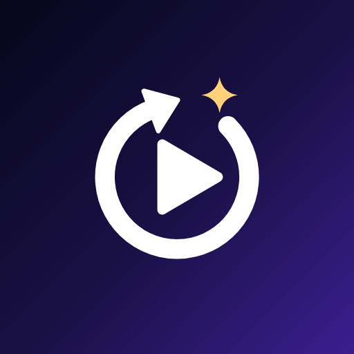
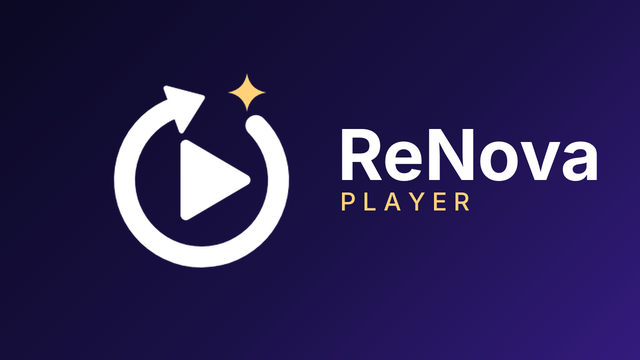

<p align="center">
  
</p>

<h1 align="center">ReNova Player</h1>

<p align="center">
  <b>A video player for your network shares that never touches your files.</b><br>
  A safety-first, community fork of <a href="https://github.com/nova-video-player/aos-AVP">NOVA Video Player</a>, patched the way <a href="https://revanced.app">ReVanced</a> patches apps.
</p>

<p align="center">
  
</p>

> 🇵🇱 **Po polsku:** ReNova Player to fork odtwarzacza NOVA, który traktuje Twoje źródła (SMB, FTP, SFTP, WebDAV, UPnP, dyski lokalne) **wyłącznie do odczytu** – jak Kodi. Aplikacja nie potrafi już niczego skasować, przenieść, zmienić nazwy ani dopisać do Twoich folderów z filmami. Dane ze scrapera, edytowane opisy, punkty wznowienia i pobrane napisy zostają na urządzeniu. Do tego: edycja metadanych, pewniejsze scrapowanie (anime, dumpy, polskie nazwy „Sezon/Odcinek/odc.”), poprawne rozpoznawanie lektora PL i nowa, ciemna identyfikacja wizualna.

## Why this fork exists

NOVA is a capable player, but out of the box it is **dangerous for the files it plays**:

- **One-tap deletion of real files** on your shares and local storage, straight from the player UI: a single video, a multi-selection, a folder, **every episode of a TV show** or **every movie of a collection**. There is no trash: on SMB/FTP/SFTP/WebDAV a deleted file is gone for good.
- When a deletion starts, the video is **removed from the library before** the file operation even runs, so a failed delete leaves the library out of sync with the disk.
- It **writes into your media folders**: `.nfo`/`.jpg` exports next to videos, hidden `.archosresume.xml` resume files on network shares, subtitles saved next to the video, and the subtitles wizard **renames subtitle files on the drive**.
- A database cleanup trigger deletes files by absolute path without checking where they live.

None of this belongs in a player. ReNova removes the buttons **and** makes the underlying operations impossible.

## What ReNova changes

### 🔒 Read-only sources (Kodi way)
- Every file access backend (SMB via smbj and jcifs, FTP/FTPS, SFTP via sshj and jsch, WebDAV, SAF documents, zip, local storage) **refuses** delete, write, rename, move, mkdir and touch outside the app's own private directories. This is enforced in one place, `SourceAccessPolicy`, below the UI, and covered by unit tests.
- MediaStore delete/rename requests are refused too.
- All delete / copy-to-device / NFO export entries are gone from the phone and TV interfaces; the delete code paths refuse before touching the library.
- Scraped metadata, your edits, resume points and downloaded subtitles stay **on the device**. NFO files on the shares are still **read** (Kodi-compatible), never written.
- Opening a compressed `.torrent` no longer rewrites it in place.
- The subtitles wizard associates a subtitle by copying it into the private cache instead of renaming it on the drive.

### ✏️ Edit metadata
- *Edit info* on movies, episodes (phone menu and TV actions) and TV shows: title, year, plot, rating, age rating, season/episode numbers.
- Your edits are remembered and **re-applied on every later scrape** (automatic, "rescrape all", NFO import), like locked fields in Kodi. *Forget my edits* returns to scraped data.

### 🔎 Better scraping
- Scraping **keeps running when the app goes to background** (TV sleep, home button) instead of stopping half way, and **retries network failures** as soon as the network is back.
- **Anime and streaming dumps**: `Frieren/S01E05.mkv`, `Frieren/Sezon 2/Odcinek 05.mp4`, `Frieren/05.mkv`, `[SubsPlease] Sousou no Frieren - 05 (1080p).mkv`, `Frieren odc. 5.mp4` are recognized as episodes, with the show title taken from the folders, instead of being searched as movies named "05".

- **Anime titles resolved with [AniList](https://anilist.co)**: romaji / fansub names TMDb does not know ("Sousou no Frieren") are looked up on AniList's official API and searched again on TMDb under their english/romaji/native titles. ([Shinden](https://shinden.pl) has no public API, so it is not used.)
- **No more Japanese-only texts**: when TMDb has no translation in your language, titles and plots fall back to English instead of the original 葬送のフリーレン with an empty plot.

### 🖼️ Sharper artwork
- Posters downloaded at w780 (were w500, collections w342) and episode stills at full size scaled to 780px (were 300px thumbnails): no more soft covers on TVs.

### 🛡️ Robustness
- **Libraries no longer vanish** when a NAS is still asleep or a share answers empty: a rescan that would wipe most of a source is held back until the next scan confirms it (Kodi never auto-cleans either).
- **Progress is kept** when you leave a resumed video while it is still loading (it used to be reset to 0).
- The confusing per-video *Remove from library* action is gone: it only hid entries, with no way to bring them back.

### ▶️ Player
- Kodi-like **buffering progress** ("Buffering 45%") when playback waits for data.
- Double tap seeking adds up (3 taps = 30 s) into one seek kept inside the video, with the target time shown — it used to hang network files in endless buffering.
- Stop button, horizontal **swipe to seek** (Kodi/MX style, preview of the target time), clock style times (`1:25`, `1:05:30`), screen format button with an aspect ratio icon and the format name shown on switch.
- Modern controls: play/pause in a soft circle, clean rewind/forward, gold highlight, gradient bar instead of a grey slab, shadows on texts for readability.
- Optional **cinema mode** (like YouTube's ambient mode): the bars around the picture glow softly with the colors of the scene instead of being black.
- Brightness is never written to the system nor remembered; the brightness button is gone and the swipe is an opt-in setting on the left edge only.

### 🔊 Correct audio language
- A polish voice-over (*lektor*) or dub tagged `eng`/`und` in the container is detected from the track title (`Lektor PL`, `Dubbing`, `Polski`…) or the release name (`PL.LEKTOR`, `PLDUB`, `[Lektor PL]`), so the preferred-language track is picked and labelled correctly. Works for other languages' track titles too (Deutsch, VFF, Castellano…).

### 🌙 Modern dark look
- Material 3 dark themes on phone screens with the ReNova palette (indigo surfaces, violet primary, gold highlights); the TV interface follows the same palette.
- Animated splash screen (the renewal arrow spins into place, the nova spark flares) and a blur-in entrance into the app.
- Cinematic backdrops: the artwork stays sharp, only the text side and the bottom fade into the background (instead of dimming the whole picture).

### 🎨 New identity
- ReNova Player name, dark logo (a renewal arrow around a play button, with a nova spark), TV banner and status bar icon. Sources in [`branding/`](branding).
- Separate package `io.github.oop23.renova` with its own content providers: **installs next to the original NOVA**.

### Roadmap
- Deeper anime support: AniList/MyAnimeList ids, absolute episode numbering (One Piece 1050), anime-first matching for anime folders.
- Better poster/backdrop selection and image quality, nicer blur effects.
- Further mobile UI modernization (browse and details screens), data source logos (TMDb / AniList / NFO) on details.

## Versions

ReNova versions read `<renova>-nova<base>`: **`0.1-nova6.5.5`** is ReNova 0.1 built on NOVA 6.5.5. The first number moves with ReNova's own changes, the second with the upstream release the patches are rebased on.

## Help

See the [Help / FAQ](faq/renova.md) (English and Polish), also reachable from *Settings → About*.

## Download

Every push builds an APK (arm64 + armv7) in [GitHub Actions](https://github.com/oop23/re-aos-AVP/actions/workflows/build.yml): open the latest green run and download the `apk` artifact. Debug-signed builds for now.

## How the fork is built

This repository does not mirror NOVA's sources. Like ReVanced, it holds **patches**:

```
default.xml            manifest: upstream repos, Video/MediaLib/FileCoreLibrary pinned to exact commits
patches/<project>/     the fork's changes, one reviewable patch per feature
script/fetch-sources.py  shallow-clone every project of the manifest (no repo tool needed)
script/apply-patches.sh  apply patches/ on top of the upstream checkouts
script/export-patches.sh regenerate patches/ from local commits
branding/              logo, banner and their SVG sources
```

Build locally (Linux, Android SDK + NDK installed):

```sh
mkdir renova && cd renova
git clone https://github.com/oop23/re-aos-AVP AVP
python3 AVP/script/fetch-sources.py AVP/default.xml . --skip AVP
cp AVP/Makefile Makefile
AVP/script/apply-patches.sh .
cd Video && ./gradlew -Puniversal assembleNoamazonDebug
```

The [repo tool](https://source.android.com/source/downloading) works too: `repo init -u https://github.com/oop23/re-aos-AVP -b nova && repo sync`, then `AVP/script/apply-patches.sh`.

To work on a patch: commit in `Video/`, `MediaLib/` or `FileCoreLibrary/` on top of the pinned revision, then run `AVP/script/export-patches.sh`. Moving to a newer upstream means bumping the revisions in `default.xml` and rebasing the patches.

Build requirements are the ones of upstream NOVA:

```sh
sudo apt install build-essential python3 python3-pip python3-setuptools ninja-build maven file wget curl unzip git pkg-config meson nasm openjdk-17-jdk-headless
```

## Credits and license

ReNova Player is built on the work of the [NOVA Video Player](https://github.com/nova-video-player) team and of the original [Archos Video Player Community Edition](https://github.com/archos-sa/aos-AVP). It is not affiliated with them; please do not report ReNova issues to NOVA.

Scraping uses [TMDb](https://www.themoviedb.org/) and scrobbling [Trakt](https://trakt.tv).

Licensed under the [Apache License 2.0](LICENSE.txt), like upstream.
